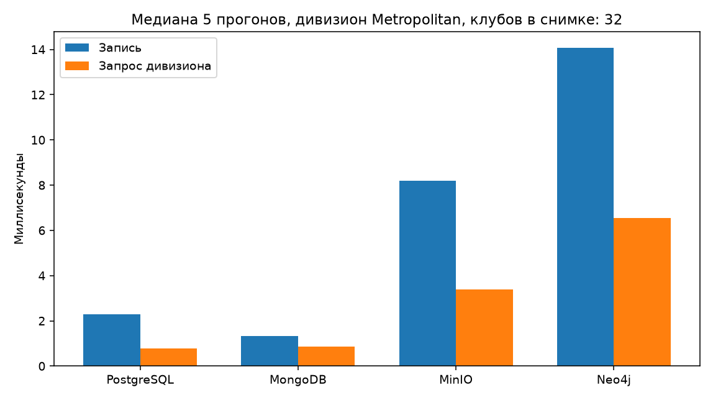
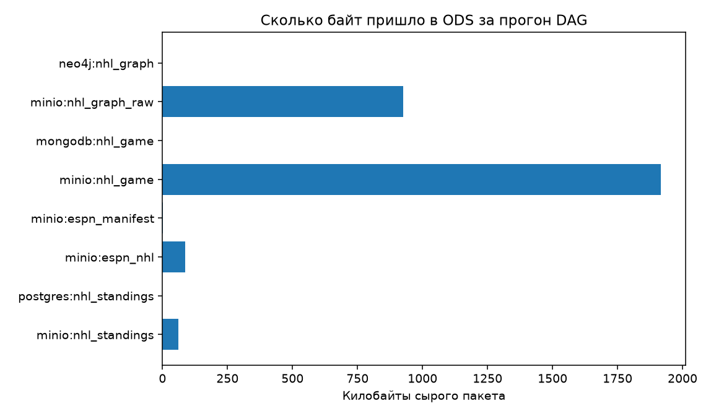

# Отчёт по лабораторной работе № 1

## «Работа с Airflow. ETL-процесс»

## 1. Цель работы

Разработать ETL-процессы сбора открытых данных, организовать их выполнение с помощью Apache Airflow, загрузить сырые данные в слой ODS и сравнить разные способы хранения полученных данных.

В работе реализованы четыре DAG и четыре сервиса хранения: PostgreSQL, MongoDB, S3-совместимое объектное хранилище и Neo4j. Таким образом, требования о трёх процессах и трёх хранилищах выполнены с дополнительным графовым представлением данных.

## 2. Исходные данные

Предметная область — хоккейная статистика NHL. Используются два открытых HTTP-источника, возвращающих JSON без API-ключа.

### 2.1. NHL Web API

Базовый адрес: `https://api-web.nhle.com`.

Из него извлекаются:

- турнирная таблица на текущую и исторические даты;
- расписание матчей;
- итоговые протоколы — box score;
- последовательность событий матча — play-by-play;
- текущие составы команд.

Используемые пути:

```text
/v1/standings/now
/v1/standings/{date}
/v1/schedule/now
/v1/schedule/{date}
/v1/gamecenter/{game_id}/boxscore
/v1/gamecenter/{game_id}/play-by-play
/v1/roster/{team_abbrev}/current
```

Эти ответы содержат как табличные данные, так и вложенные массивы событий и игроков. Это позволяет сравнивать реляционную, документную, объектную и графовую модели хранения в одной предметной области.

### 2.2. ESPN

Базовый адрес: `https://site.api.espn.com`.

Используемые пути:

```text
/apis/site/v2/sports/hockey/nhl/scoreboard
/apis/site/v2/sports/hockey/nhl/news
```

Загружаются табло NHL и новостная лента. ESPN выступает независимым источником событий и текстовых данных, дополняющим статистику лиги.

HTTP-клиенты источников: [nhl.py](plugins/thbd/nhl.py), [espn.py](plugins/thbd/espn.py), [client.py](plugins/thbd/client.py).

Поскольку контракты используемых веб-эндпоинтов могут измениться, исходные ответы сохраняются полностью для последующего повторного разбора.

## 3. Этап 1. Развёртывание Apache Airflow

Инфраструктура описана в [docker-compose.yaml](docker-compose.yaml) на основе Docker Compose-конфигурации Apache Airflow. Версия Airflow в проекте — `3.3.2`, исполнитель задач — `CeleryExecutor`.

В состав инфраструктуры входят:

- `airflow-apiserver` — веб-интерфейс и API;
- `airflow-scheduler` — планирование запусков;
- `airflow-dag-processor` — обработка файлов DAG;
- `airflow-worker` — выполнение задач;
- `airflow-triggerer` — поддержка отложенных задач;
- `redis` — брокер очереди Celery;
- `postgres` — служебная база метаданных Airflow;
- четыре сервиса хранения предметных данных.

Образ с зависимостями собирается из [Dockerfile](Dockerfile). Python-зависимости перечислены в [requirements.txt](requirements.txt). Пример настроек окружения — [.env.example](.env.example).

Служебная база Airflow отделена от базы ODS: метаданные запусков находятся в сервисе `postgres`, а данные NHL — в `postgres-ods`.

Контейнеры используют постоянные Docker volumes. Остановка командой `docker compose down` сохраняет данные. Удаление volumes выполняется отдельно и приводит к удалению сохранённых данных.

## 4. Этап 2. Выбор и развёртывание хранилищ

### PostgreSQL

Назначение — хранение снимков турнирной таблицы в `ods.nhl_standings`.

Структура исходных строк стабильна: дата, команда, дивизион, очки, победы и поражения. Реляционная модель позволяет использовать ключи, индексы и SQL-фильтрацию. Помимо выделенных колонок сохраняется исходная строка в `raw_payload` типа `jsonb`.

DDL находится в [sql/001_ods.sql](sql/001_ods.sql).

### MongoDB

Назначение — хранение протоколов в коллекции `nhl_ods.games`.

Один матч представлен одним документом. Документ содержит счёт, команды, массив `plays`, исходный box score и play-by-play. Такая модель сохраняет вложенность событий без преждевременного разложения на множество таблиц.

### S3-совместимое объектное хранилище

Назначение — архив исходных JSON всех процессов и основной приёмник данных ESPN. Используется бакет `nhl-raw`.

**Фактическая реализация в Compose — Silo, образ `pgsty/silo:RELEASE.2026-09-16T00-00-00Z`.** Сервис и настройки в коде называются `minio`; взаимодействие осуществляется через S3 API с помощью `boto3`. При демонстрации в интерфейсе может отображаться название Silo. Это объектное S3-хранилище, а не официальный контейнер MinIO.

Объекты сохраняются по ключам с названием сущности, датой или ID матча и идентификатором загрузки. Например:

```text
nhl/standings/dt=2026-10-23/batch=<batch_id>.json
nhl/game/game=<game_id>/batch=<batch_id>.json
espn/manifest/latest.json
```

### Neo4j

Назначение — хранение связей между командами, дивизионами, конференциями, матчами и игроками.

Используются узлы `Conference`, `Division`, `Team`, `Game`, `Player` и связи `IN_CONFERENCE`, `IN_DIVISION`, `PLAYED_HOME`, `PLAYED_AWAY`, `PLAYS_FOR`, `APPEARED_IN`.

Граф позволяет наглядно исследовать соперников команды и участие игроков в матчах. Реализация загрузки — [graph.py](plugins/thbd/graph.py).

## 5. Этап 3. Реализация ETL-процессов

Во всех процессах сначала выполняется извлечение JSON и запись исходного пакета в объектный архив. Затем следующий task читает сохранённый объект и загружает проекцию в целевое хранилище либо формирует manifest.

В архиве вместе с `payload` сохраняются `source_urls`, `fetched_at` и `batch_id`. Между задачами передаются ключи объектов и небольшие служебные данные; большие протоколы не передаются через XCom.

### 5.1. Турнирная таблица → PostgreSQL

Исходный код: [nhl_standings_to_postgres.py](dags/nhl_standings_to_postgres.py).

Порядок выполнения:

1. Получить текущую таблицу и недельные исторические снимки.
2. Удалить повторные даты внутри пакета.
3. Сохранить исходные ответы в объектном хранилище.
4. Привести локализованные поля к строкам и выделить атрибуты для SQL.
5. Загрузить строки в `ods.nhl_standings`.

Уникальный ключ — `(standings_date, team_abbrev)`. Используется `INSERT ... ON CONFLICT ... DO UPDATE`, поэтому повторная загрузка того же снимка обновляет строки без дублирования.

Расписание — ежедневно в **12:00 UTC**.

### 5.2. Протоколы матчей → MongoDB

Исходный код: [nhl_games_to_mongodb.py](dags/nhl_games_to_mongodb.py).

Порядок выполнения:

1. Пройти по нескольким неделям расписания, используя `previousStartDate`.
2. Выбрать завершённые матчи со статусом `OFF`.
3. Проверить, какие `game_id` уже есть в MongoDB.
4. Для новых матчей получить box score и play-by-play и записать их в архив.
5. Сформировать и загрузить по одному документу на матч.

Идентификатор документа — строковый `game_id`. Уже загруженные матчи пропускаются, если `NHL_REFRESH` не равен `1`; при загрузке документ заменяется по ключу. Ограничение `NHL_MAX_GAMES` задаёт размер выборки одного запуска, а не общий предел накопленной коллекции.

Расписание — ежедневно в **12:30 UTC**.

### 5.3. Табло и новости ESPN → объектное хранилище

Исходный код: [espn_nhl_to_minio.py](dags/espn_nhl_to_minio.py).

Порядок выполнения:

1. Получить табло и новости NHL с ESPN.
2. Сохранить оба исходных JSON в бакете `nhl-raw`.
3. Прочитать сохранённые ответы следующим task.
4. Сформировать короткий manifest с матчами и заголовками новостей.

Основной результат — исходные объекты и `espn/manifest/latest.json`. Manifest позволяет быстро проверить содержимое загрузки в интерфейсе S3-хранилища.

Расписание — ежедневно в **13:00 UTC**.

### 5.4. Команды, матчи и игроки → Neo4j

Исходный код: [nhl_graph_to_neo4j.py](dags/nhl_graph_to_neo4j.py).

Порядок выполнения:

1. Получить таблицу, расписание, составы команд и ограниченный набор box score.
2. Сохранить исходные ответы в объектном архиве.
3. Создать ограничения уникальности графовых сущностей.
4. Создать или обновить узлы и связи с помощью `MERGE`.

Перед записью текущей связи `PLAYS_FOR` прежняя связь игрока с клубом удаляется. Это представление текущего состава, а не история переходов. Историческая обработка относится к следующей лабораторной работе.

Расписание — ежедневно в **14:00 UTC**.

## 6. Устойчивость и наблюдаемость

Для DAG установлены `catchup=False` и `max_active_runs=1`: пропущенные интервалы не запускаются автоматически пачкой, одновременно выполняется не более одного запуска конкретного DAG.

HTTP-клиент делает паузу 0,25 секунды между попытками обращения, использует таймаут 45 секунд и до пяти попыток. Для ответа HTTP 429 предусмотрено увеличенное ожидание. Дополнительно настроены повторы задач Airflow.

Идемпотентность обеспечивается ключом снимка в PostgreSQL, ключом документа в MongoDB и `MERGE` с ограничениями уникальности в Neo4j. В объектном архиве сохраняются пакеты загрузок, а указатели `latest.json` перезаписываются. Архивирование новых пакетов следует отличать от дублирования сущностей в рабочих проекциях.

Если task загрузки проекции падает, исходный объект уже находится в архиве. Повтор именно этого task может прочитать его без повторного запроса к API.

В `ods.ingest_log` регистрируются DAG, целевое хранилище, сущность, число записей, объём JSON и продолжительность этапа. Исходный код клиентов хранилищ и журнала — [stores.py](plugins/thbd/stores.py).

## 7. Этап 4. Результаты загрузки

Сохранённый протокол первого сравнительного запуска от **23 октября 2026 года** находится в [analysis/output/results.md](analysis/output/results.md).

В этом запуске получены:

- снимок таблицы из 32 команд;
- 12 протоколов матчей, исходный пакет размером 1 962 107 байт;
- табло и новости ESPN объёмом 88 518 байт;
- пакет графовых исходных данных размером 948 901 байт.

Первичная загрузка 12 документов в MongoDB заняла 358 мс; загрузка графовой проекции — 2 740 мс. Извлечение протоколов с записью в архив заняло 21 109 мс. Последнее время включает сеть и ожидания HTTP-клиента, поэтому его нельзя трактовать как чистую скорость базы данных.

Затем корпус был расширен. При последующей проверке на **30 октября 2026 года**, зафиксированной в [результатах обработки ODS второй работой](../lab2/results/actual.json), входной набор содержал **546 матчей, 3 475 уникальных событий голов и 288 строк турнирной таблицы**. Этот набор отличается от небольшого снимка, использованного для сравнительного эксперимента.

Число документов может увеличиваться после следующих ежедневных запусков. Актуальные объёмы проверяются командами и запросами из раздела демонстрации.

## 8. Этап 5. Сравнительный анализ хранилищ

### 8.1. Методика

Скрипт эксперимента: [analysis/compare_storages.py](analysis/compare_storages.py).

Во все четыре хранилища загружается **одинаковый снимок таблицы из 32 клубов**. Затем выполняется одинаковая по смыслу операция: выбрать клубы дивизиона Metropolitan и отсортировать по очкам. Ожидаемый результат — восемь клубов.

Выполняется пять повторов; итоговая характеристика — медиана времени. Для объектного хранилища запрос включает чтение JSON и фильтрацию в Python. Для Neo4j используются отдельные узлы `BenchTeam`, чтобы эксперимент не изменял рабочий граф.

Критерии сравнения:

1. Соответствие модели хранения структуре исходных данных.
2. Время записи одинакового пакета.
3. Время получения одинакового результата.
4. Способ предотвращения дублей при повторной загрузке.
5. Удобство SQL-аналитики, работы с вложенными событиями и обхода связей.
6. Возможность сохранить и повторно разобрать исходный ответ.

### 8.2. Измеренные результаты

Замер выполнен на снимке от 23 октября 2026 года. Медианы пяти повторов:

- **PostgreSQL:** запись — 2,28 мс; запрос — 0,77 мс.
- **MongoDB:** запись — 1,32 мс; запрос — 0,86 мс.
- **S3-хранилище:** запись — 8,20 мс; запрос — 3,38 мс.
- **Neo4j:** запись — 14,08 мс; запрос — 6,54 мс.



Объём исходных пакетов по журналу загрузок:



Машиночитаемый протокол: [analysis/output/results.json](analysis/output/results.json).

### 8.3. Интерпретация и ограничения

Для плоской таблицы PostgreSQL и MongoDB показали близкие времена чтения. S3-хранилище требует загрузить объект целиком и обработать его прикладным кодом. Neo4j имеет дополнительные накладные расходы для простого фильтра по атрибуту, хотя подходит для обхода отношений.

Снимок из 32 строк слишком мал для заключений о производительности на больших объёмах. Время зависит от среды Docker, прогрева и накладных расходов клиента. Не измерялись масштабирование, отказоустойчивость и ресурсопотребление при высокой нагрузке. Приведённые числа характеризуют конкретный эксперимент.

### 8.4. Выбор наиболее подходящего хранилища

**В качестве основной базы для дальнейшей структурированной аналитики выбрана PostgreSQL.** Выбор основан на SQL, индексах, ограничениях целостности и возможности совместить типизированные колонки с исходным JSONB. Это также позволяет построить детальный слой и витрины следующими лабораторными работами.

Другие сервисы выполняют дополнительные роли: S3 сохраняет оригиналы ответов, MongoDB удобно хранит вложенные протоколы, Neo4j представляет отношения между участниками соревнований. Выбор PostgreSQL не означает, что она должна заменить архив или граф во всех задачах.

## 9. Порядок воспроизведения и демонстрации

### 9.1. Запуск инфраструктуры

Из корня репозитория:

```bash
cd lab1
# При первом запуске, если .env отсутствует:
cp .env.example .env
docker compose build
docker compose up airflow-init
docker compose up -d
docker compose ps
```

Если `.env` уже существует и настроен, копировать его повторно не требуется.

Веб-интерфейс Airflow: `http://localhost:8080`, учебная учётная запись `airflow / airflow`.

Показать четыре DAG с тегом `lab1`. Запуск:

```bash
bash scripts/trigger_all.sh
```

Дождаться успешного завершения задач. В Airflow показать граф зависимостей и журнал одного task загрузки.

### 9.2. Данные в хранилищах

Краткая проверка всех хранилищ:

```bash
bash scripts/show_counts.sh
```

PostgreSQL: `localhost:5433`, база `nhl_ods`, пользователь `nhl`, пароль `nhlods`. Примеры SQL: [sql/demo_queries.sql](sql/demo_queries.sql).

```sql
SELECT count(*) AS rows, count(DISTINCT standings_date) AS snapshot_dates
FROM ods.nhl_standings;

SELECT team_abbrev, division_name, points
FROM ods.nhl_standings
WHERE standings_date = (SELECT max(standings_date) FROM ods.nhl_standings)
ORDER BY points DESC;

SELECT dag_id, storage, entity, records_loaded, payload_bytes, duration_ms
FROM ods.ingest_log
ORDER BY loaded_at DESC;
```

MongoDB: `localhost:27017`, база `nhl_ods`, пользователь `nhl`, пароль `nhlods`, база аутентификации `admin`. Запросы: [mongo/demo_queries.js](mongo/demo_queries.js). Показать один документ и вложенный массив событий.

Консоль S3-хранилища: `http://localhost:9001`, `minioadmin / minioadmin`. Показать бакет `nhl-raw`, исходный JSON и manifest ESPN.

Neo4j Browser: `http://localhost:7474`, `neo4j / nhlgraph`. Запросы: [cypher/demo_queries.cypher](cypher/demo_queries.cypher). Показать команды, матчи и связанные узлы.

### 9.3. Сравнительный эксперимент

```bash
docker compose exec -T airflow-scheduler \
  python /opt/airflow/analysis/compare_storages.py
```

Открыть графики и результаты из `analysis/output`. Повторный запуск эксперимента обновляет файлы измерений; новые числа могут отличаться от сохранённого протокола.

## 10. Исходный код и конфигурация, предоставляемые для защиты

Инфраструктура:

- [Docker Compose](docker-compose.yaml).
- [Dockerfile Airflow](Dockerfile).
- [Python-зависимости](requirements.txt).
- [Пример переменных окружения](.env.example).

ETL-процессы:

- [Таблица NHL → PostgreSQL](dags/nhl_standings_to_postgres.py).
- [Протоколы NHL → MongoDB](dags/nhl_games_to_mongodb.py).
- [ESPN → S3-хранилище](dags/espn_nhl_to_minio.py).
- [Граф NHL → Neo4j](dags/nhl_graph_to_neo4j.py).

Общие модули:

- [HTTP-клиент](plugins/thbd/client.py).
- [Клиент NHL](plugins/thbd/nhl.py) и [клиент ESPN](plugins/thbd/espn.py).
- [Преобразования](plugins/thbd/transform.py).
- [Клиенты хранилищ](plugins/thbd/stores.py).
- [Загрузка графа](plugins/thbd/graph.py).
- [Настройки](plugins/thbd/settings.py).
- [DDL ODS](sql/001_ods.sql).
- [Скрипт сравнительного эксперимента](analysis/compare_storages.py).

## 11. Вывод

Развёрнут Apache Airflow в Docker Compose, подключены четыре сервиса хранения и реализованы четыре ETL-процесса. Процессы сохраняют исходные ответы, загружают проекции в ODS и регистрируют характеристики загрузки. Выполнено сравнение хранилищ на одинаковом наборе данных, сохранены численные результаты и графики. PostgreSQL выбрана основной базой для дальнейшей аналитической обработки, остальные сервисы используются для архива, вложенных документов и связей.
